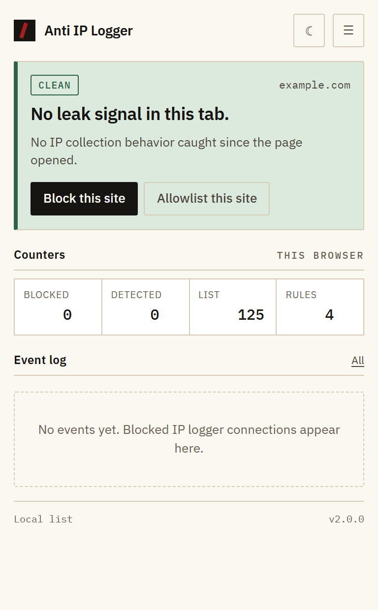
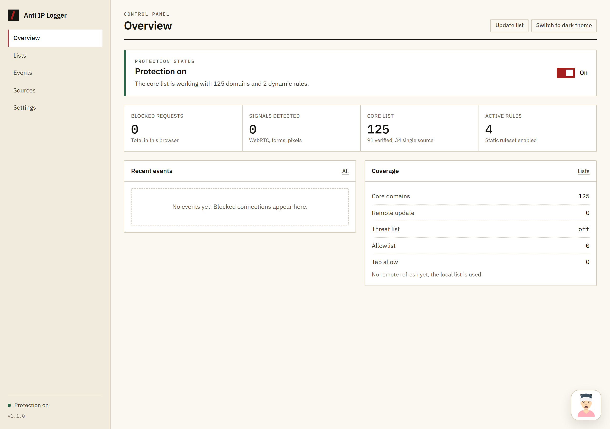
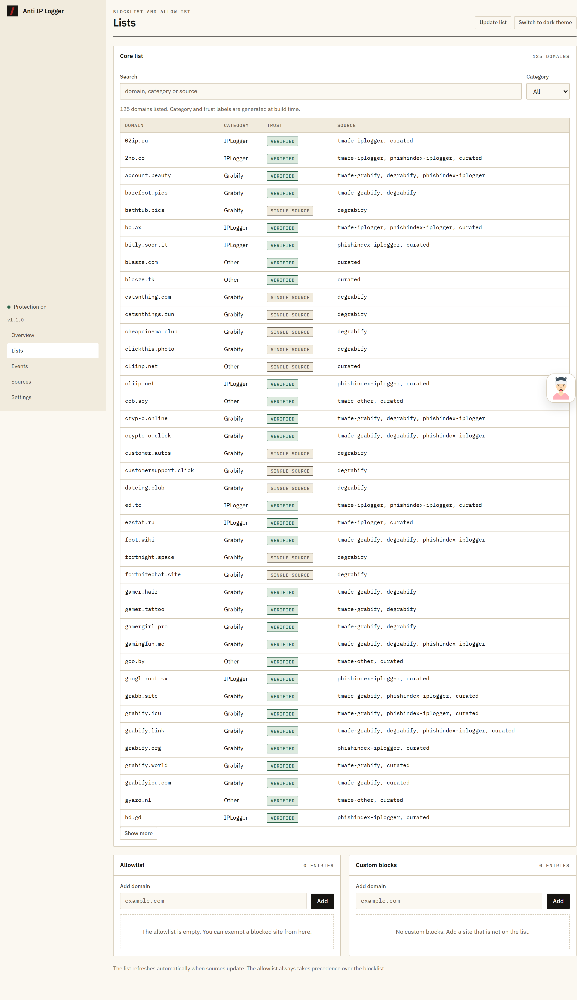
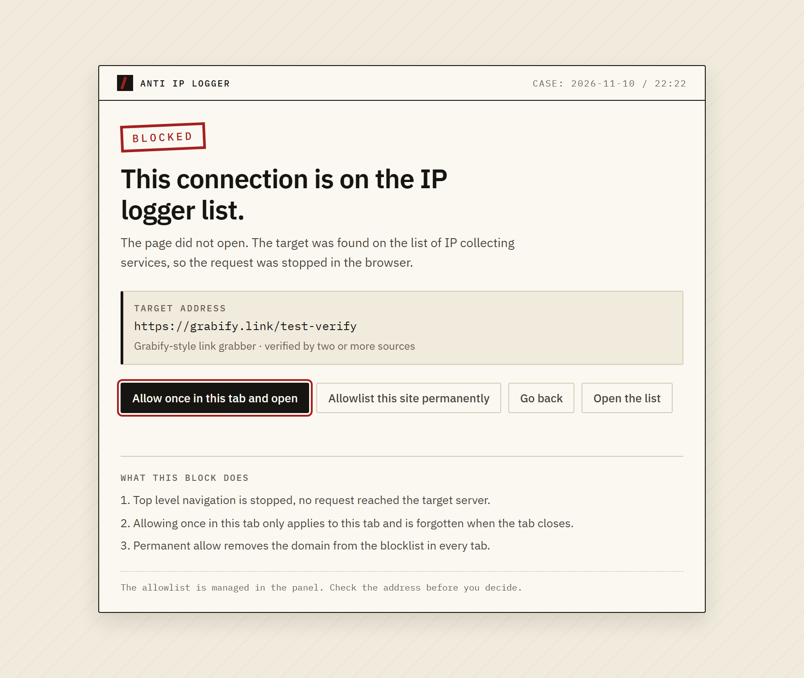
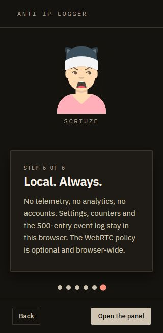

[](https://github.com/supposedtobescruz/anti-ip-logger/actions/workflows/verify.yml)
[](https://github.com/supposedtobescruz/anti-ip-logger/blob/main/PRIVACY.md)

# Anti IP Logger

**Languages:** English | [Türkçe](readme/readmeTR.md)

Anti IP Logger is a Chrome extension that blocks known IP logger and link grabber domains, then reports IP leak attempts it finds on the page. Manifest V3, vanilla JavaScript, no build step.

Version 1.3.0. The bundled list ships 125 domains in 2 static rules, with 61 exceptions.

## What it does

- Blocks top-level navigation to known IP logger and Grabify-style domains before the request reaches the network stack.
- Shows an explanation page instead of the blocked address. Nothing is sent to the target server.
- Watches the page for IP leak signals: WebRTC candidate dumps, click-less form submits, hidden iframes and tracking pixels, meta refresh redirects, and pre-gesture third-party requests.
- Shows an in-page warning banner only when the evidence justifies it (a danger-level finding, or two distinct warning categories at once). A single weak signal stays a badge in the popup.
- Keeps an event log and lifetime counters in the panel, capped at the last 500 events.
- Lets you allowlist domains, block custom domains, and grant one-tab temporary fixes.
- Refreshes the core list from maintained sources. If sources fail, the previous list is kept; it never writes an empty list over a good one.
- Shows a verdict-colored toolbar icon per tab (blocked, warning or idle).
- Shows a dismissible notice in the panel when a newer version is available.
- Opens a six-step welcome tour on first install, with Scruize, the mascot. Replay it any time from Settings → About.
- The interface is in English by default, with full Turkish support. Override it (Same as browser, English, Türkçe) from Settings → Privacy and appearance.

## What it does not do

- It is not a VPN. It does not hide your IP address.
- It does not filter DNS, email, or non-browser traffic.
- It does not do visual inspection. A list entry can be a false positive; the allowlist exists for that.
- It does not send anything to a remote server. No telemetry, no analytics, no crash reporting.

## Screenshots








## Install

1. Download or clone this repository.
2. Open your browser's extensions page: `chrome://extensions` (Chrome, Brave, Vivaldi), `edge://extensions` (Edge) or `opera://extensions` (Opera).
3. Enable **Developer mode** (top right) if you are installing unpacked from the repository.
4. **Microsoft Edge only:** install from Edge Add-ons at https://microsoftedge.microsoft.com/addons/detail/anti-ip-logger/ikfmjolkbcoghibpiicldoiadhbokpai (1.3.0).
5. **Unpacked install:** click **Load unpacked** and pick the repository root.
6. The panel opens on install. The toolbar icon opens the popup.

`manifest.json` must be in the directory you pick. Do not select a subfolder.

## Browser support

- **Microsoft Edge:** published in Edge Add-ons (see link above), reviewed as 1.3.0.
- **Brave:** verified locally, 32/32 browser checks on Brave 157.
- **Google Chrome, Opera, Vivaldi (Chromium 111 or newer):** the package uses only standard Chromium Manifest V3 APIs and declares `minimum_chrome_version: 111`. Expected to work; Chrome Web Store is deliberately not submitted yet, and Opera/Vivaldi were not run on this machine, so load unpacked and test before relying on them.
- **Firefox, Safari:** not supported yet. They require different packaging (gecko ring for AMO; Xcode conversion for Safari).
- Content scripts run in the MAIN world (`world: MAIN`), which requires Chromium 111. Pages that spoof the signal channel can fool the banner, not the blocklist; see Known limits.

## Usage

- **Popup:** the verdict for the active tab, risk signals, counters, recent events. "Siteyi engelle" adds the host to your custom blocklist, "İzin listesine ekle" allowlists it, "Bu sekmede izin ver" grants a one-tab pass.
- **Panel** (options page): Overview, Lists, Events, Sources, Settings. Search the core list, manage allow/custom lists, check source health, back up and reset your data.
- **Blocked page:** the target URL, which list entry matched, and three decisions: allow once in this tab, allow the site permanently, or go back.

The extension interface is in English (default) and Turkish, following your browser's UI language (`chrome.i18n`). This file is the English source of truth; the Turkish UI translation ships in `_locales/tr/messages.json`.

## Data sources

The core list is generated at build time. Nothing is fetched at install time.

| Source | License | What it provides |
|---|---|---|
| TMAFE anti-grabify | MPL-2.0 | Grabify, IPLogger and other service domains |
| PhishIndex IP logger list | MIT | IP logger domains |
| DeGrabify plain domain list | No explicit license, attribution given | Current Grabify domains |
| Hand-reviewed entries | This repository | Services and exceptions the feeds miss |

- Exceptions are removed at build time, not written into the default allowlist. The user allowlist starts empty.
- The threat list is optional and off by default.
- Source health is reported in the Sources tab; failures keep the previous list.
- Details and full license texts: [THIRD-PARTY-LICENSES.md](THIRD-PARTY-LICENSES.md).

## Development

Node 20.12 or later. There are no dependencies and no build step.

```powershell
npm run build           # fetch sources and regenerate the list
npm run build:offline   # regenerate from the committed dataset
npm run check           # verify the committed dataset is in sync
npm test                # unit tests
npm run verify          # manifest, files, rules, data and em dash checks
npm run verify:ui       # accessibility, contrast and interface checks
npm run verify:browser  # load in Brave/Chrome and capture screenshots
npm run verify:all      # check + test + verify + verify:ui
```

`verify:browser` writes screenshots and `report.json` into `verify-output/`. If Brave or Chrome is not in its default location, set `BRAVE_PATH` to the browser executable.

### Architecture

```
background.js          service worker, message bus, DNR apply, sync
lib/constants.js       permissions, priorities, default settings
lib/parser.js          list parsing, host normalization, subdomain dedup
lib/domains.js         registrable domain and matching helpers
lib/rules.js           dynamic DNR rule generation
lib/dnr.js             rule apply, static ruleset, WebRTC policy, badge
lib/risk.js            signal scoring, verdicts and i18n copy
lib/store.js           storage wrappers, session tab state
content/probe.js       MAIN world: WebRTC, media, geolocation, network hooks
content/guard.js       isolated world: DOM scan, reporting, shadow DOM banner
popup/ dashboard/ blocked/ welcome/   interface pages
assets/mascot-scruize.svg Welcome tour mascot (DiceBear avataaars)
data/                  source definitions, curated entries, exceptions, generated list
rules/core.json        static DNR rules
tools/                 build and verification scripts
```

Rule priority ladder: tab allow 110 > allowlist 100 > custom block 50 > blocked page 40 > threat list 20 > core 10.

## Privacy

- Settings, counters and the event log live in `chrome.storage.local` only.
- Tab state lives in `chrome.storage.session` and is wiped when the browser closes.
- No network requests are made except list updates (which go directly to the defined sources) and a daily version check against a public gist that returns a single version string. No intermediary server.
- The event log keeps at most 500 entries: host and a short detail, never full URLs or personal data.

## Known limits

- The WebRTC policy is browser-wide. "Browser default" leaves the policy untouched unless the extension changed it earlier and recorded a marker for it.
- If the extension changed the WebRTC policy, that change stays in place even after you uninstall the extension. To restore the browser default, pick "Browser default" first, then remove the extension.
- Subresource blocks (a blocked iframe or pixel) are stopped by DNR but are not written to the event log in production builds. The blocked counters record top-level navigations only.
- On a blocked navigation, the full URL (including its query string) is held in `chrome.storage.session` until the browser closes; the blocked page uses it for "Allow once in this tab and open". The event log never stores URLs.
- List updates need network access. Offline, the bundled list is used.
- If a source partially fails, the extension keeps entries from the previous sync and adds new ones on top. It never writes an empty list over a good one.
- The domain list ages. Grabify-style services rotate domains regularly.
- The warning banner appears only for a danger finding or two distinct warning categories at once. A single weak signal (one pixel, one hidden iframe, one early request) does not raise the banner; it shows as a badge and a finding in the popup.
- Known ad, analytics, consent and social embed domains are treated as noise by the hidden iframe and pixel scan. They produce no findings. The list lives in `content/guard.js` and is extensible.
- The banner can be hidden or removed by the page via CSS or JavaScript. The blocklist is not affected; the panel and popup still show the truth.
- The content script runs in the MAIN world, so page JavaScript can forge the signal channel. The blocklist (DNR) path is not affected; the banner and event log are.
- `host_permissions` covers `http://*/*` and `https://*/*`, the same scope as the content scripts. `webNavigation` exposes the URL of the navigation being judged. The extension makes no network requests beyond the defined list sources and the daily version check.
- The interface language applies to extension pages when they open, while the dashboard updates immediately.
- Signals are collected in the top-level document only. A subframe's own WebRTC, form or request activity is not inspected, so a forged iframe cannot steer the banner or create a rule for the page it sits in. Network blocking still applies in every frame.

## Store distribution

- **Microsoft Edge Add-ons:** published, https://microsoftedge.microsoft.com/addons/detail/anti-ip-logger/ikfmjolkbcoghibpiicldoiadhbokpai (1.3.0, 11 Nov 2026).
- **Chrome Web Store:** the listing is prepared but not submitted yet, by deliberate decision. What is ready:
  - `npm run package` builds `dist/anti-ip-logger-1.3.0-cws.zip` (runtime files only; the extracted zip passes all browser checks).
  - Store kit in `store/`: English and Turkish listings, permission justifications, screenshots, promotional tiles.
  - The privacy policy lives in `PRIVACY.md` and `docs/privacy.html`, served at https://supposedtobescruz.github.io/anti-ip-logger/privacy.html (repository is public, GitHub Pages from `docs/`).
  - A submission checklist is in `store/README.md`; the developer registration fee note is there as well.

## Adding a language

The extension interface is in English (default) and Turkish. UI strings live in `_locales/en/messages.json` and `_locales/tr/messages.json`; adding a third UI language means a new `_locales/<code>/messages.json` and the same key set.

This file is the English source of truth. Translations live in the `readme/` folder and follow the same structure, so a translator can work section by section:

1. Copy `readme/readmeTR.md` to `readme/readme<CODE>.md` (uppercase ISO 639-1, for example `readme/readmeDE.md`).
2. Translate the text. Keep file paths, commands, code blocks, URLs and brand names unchanged.
3. Add the new language to the language line at the top of this file and at the top of the translated file.
4. Open a pull request. A native speaker review is appreciated.

Available translations:

- [Türkçe](readme/readmeTR.md)

## License

The code is MIT licensed. Third-party data and fonts have their own licenses; see [THIRD-PARTY-LICENSES.md](THIRD-PARTY-LICENSES.md).
