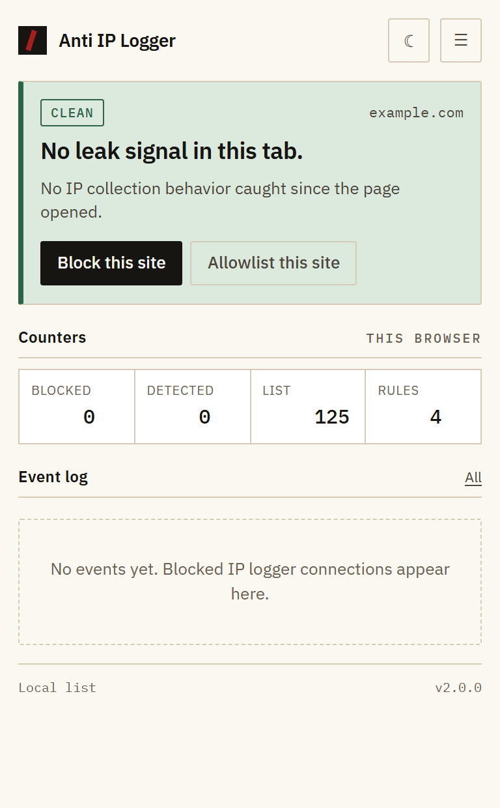
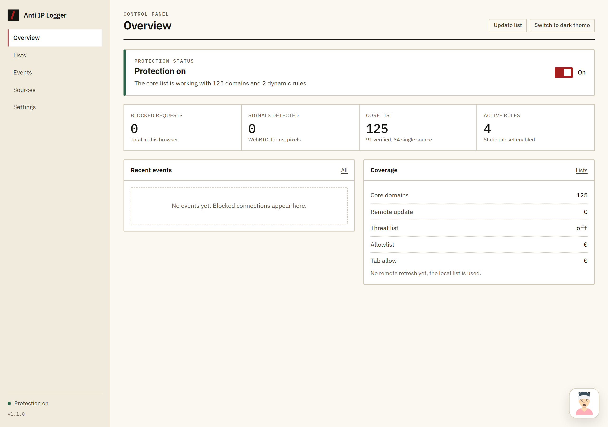
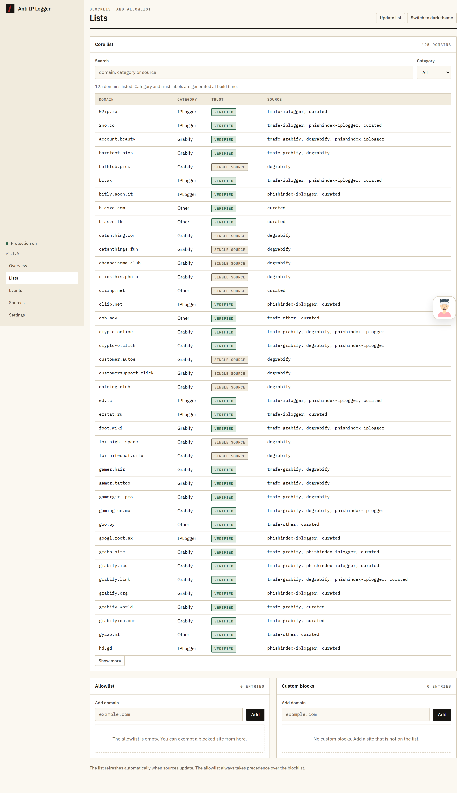
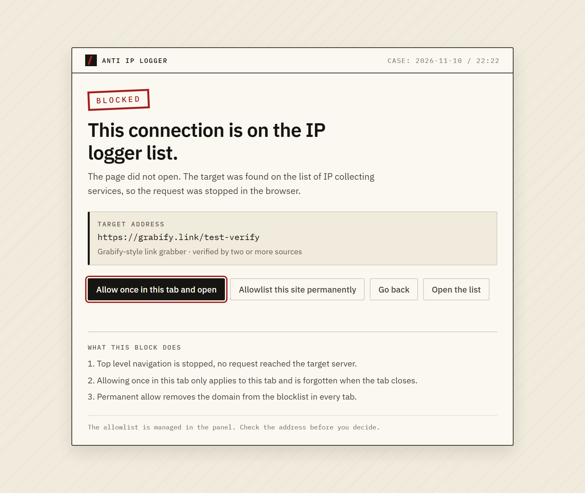
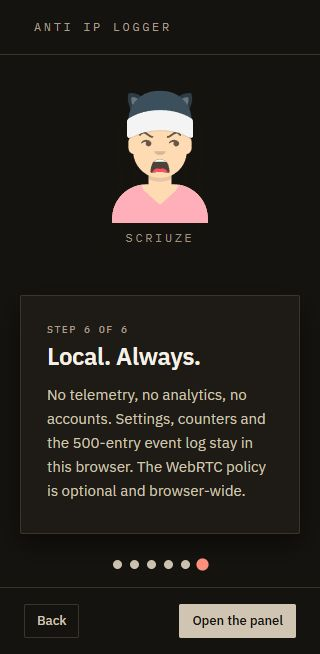

[](https://github.com/supposedtobescruz/anti-ip-logger/actions/workflows/verify.yml)
[](https://github.com/supposedtobescruz/anti-ip-logger/blob/main/PRIVACY.md)

# Anti IP Logger

**Diller:** [English](../README.md) | Türkçe

Anti IP Logger, bilinen IP logger ve link grabber alan adlarını engelleyen, ardından sayfada bulduğu IP sızıntısı girişimlerini raporlayan bir Chrome uzantısıdır. Manifest V3, vanilla JavaScript, derleme adımı yok.

Sürüm 1.2.2. Birlikte gelen liste, 2 statik kuralda 125 alan adı ve 61 istisna içerir.

## Ne yapar

- Bilinen IP logger ve Grabify tarzı alan adlarına üst düzey gezinmeyi, istek ağ yığınına ulaşmadan önce engeller.
- Engellenen adresin yerine bir açıklama sayfası gösterir. Hedef sunucuya hiçbir şey gönderilmez.
- Sayfayı IP sızıntısı sinyalleri için izler: WebRTC aday dökümleri, tıklamasız form gönderimleri, gizli iframe'ler ve izleme pikselleri, meta refresh yönlendirmeleri ve kullanıcı hareketi öncesi üçüncü taraf istekleri.
- Sayfa içi uyarı banner'ını yalnızca kanıt gerektirdiğinde gösterir (tehlike seviyesinde bir bulgu veya aynı anda iki farklı uyarı kategorisi). Tek zayıf sinyal açılır pencerede rozet olarak kalır.
- Panelde olay kaydı ve toplam sayaçlar tutulur, son 500 olayla sınırlıdır.
- Alan adlarını izin listesine eklemenize, özel alan adlarını engellemenize ve tek sekmeye geçici geçiş izni vermenize olanak tanır.
- Çekirdek listeyi bakımı yapılan kaynaklardan yeniler. Kaynaklar başarısız olursa önceki liste korunur; hiçbir zaman iyi bir listenin üstüne boş liste yazmaz.
- Sekme durumuna göre araç çubuğu simgesi renk değiştirir (engellendi, uyarı, temiz).
- Yeni sürüm çıktığında panelde kapatılabilir bir bildirim gösterir.
- İlk kurulumda altı adımlık bir hoşgeldin turu açar; Scruize, maskot. Ayarlar → Hakkında bölümünden istediğinizde yineleyebilirsiniz.
- Arayüz varsayılanı İngilizcedir, tam Türkçe desteği vardır. Tarayıcıyla aynı / English / Türkçe seçimini Ayarlar → Gizlilik ve görünüm bölümünden yapabilirsiniz.

## Ne yapmaz

- VPN değildir. IP adresinizi gizlemez.
- DNS, e-posta veya tarayıcı dışı trafiği filtrelemez.
- Görsel inceleme yapmaz. Bir liste girdisi yanlış pozitif olabilir; izin listesi bunun içindir.
- Uzak bir sunucuya hiçbir şey göndermez. Telemetri yok, analitik yok, çökme raporlama yok.

## Ekran görüntüleri








## Kurulum

1. Bu depoyu indirin veya klonlayın.
2. Chrome veya Brave'de `chrome://extensions` adresini açın.
3. **Geliştirici modu**'nu etkinleştirin (sağ üst).
4. **Paketlenmemiş öğe yükle**'ye tıklayın ve depo kökünü seçin.
5. Panel kurulumda açılır. Araç çubuğu simgesi açılır pencereyi açar.

`manifest.json`, seçtiğiniz dizinde bulunmalıdır. Alt klasör seçmeyin.

## Kullanım

- **Açılır pencere:** etkin sekmenin kararı, risk sinyalleri, sayaçlar, son olaylar. "Siteyi engelle" ana makineyi özel engelleme listenize ekler, "İzin listesine ekle" onu izin listesine alır, "Bu sekmede izin ver" tek sekmeye geçiş izni verir.
- **Panel** (seçenekler sayfası): Genel Bakış, Listeler, Olaylar, Kaynaklar, Ayarlar. Çekirdek listede arama yapın, izin ve özel listeleri yönetin, kaynak sağlığını kontrol edin, verilerinizi yedekleyin ve sıfırlayın.
- **Engel sayfası:** hedef URL, hangi liste girdisinin eşleştiği ve üç karar: bu sekmede bir kez izin ver, siteye kalıcı izin ver veya geri dön.

Uzantının arayüzü İngilizce (varsayılan) ve Türkçe olup tarayıcı arayüz dilini (`chrome.i18n`) izler. Bu dosya Türkçe çeviridir; arayüz Türkçe metinleri `_locales/tr/messages.json` içinde yaşar.

## Veri ve kaynaklar

Çekirdek liste derleme sırasında üretilir. Kurulum sırasında hiçbir şey indirilmez.

| Kaynak | Lisans | Ne sağlar |
|---|---|---|
| TMAFE anti-grabify | MPL-2.0 | Grabify, IPLogger ve diğer servis alan adları |
| PhishIndex IP logger list | MIT | IP logger alan adları |
| DeGrabify plain domain list | Açık lisansı yok, atıf verilmiştir | Güncel Grabify alan adları |
| Elle incelenen girdiler | Bu depo | Kaynakların kaçırdığı servisler ve istisnalar |

- İstisnalar derleme sırasında listeden çıkarılır, varsayılan izin listesine yazılmaz. Kullanıcı izin listesi boş başlar.
- Tehdit listesi isteğe bağlıdır ve varsayılan olarak kapalıdır.
- Kaynak sağlığı Kaynaklar sekmesinde raporlanır; başarısızlıklar önceki listeyi korur.
- Ayrıntılar ve tam lisans metinleri: [THIRD-PARTY-LICENSES.md](../THIRD-PARTY-LICENSES.md).

## Geliştirme

Node 20.12 veya üzeri. Bağımlılık yoktur ve derleme adımı yoktur.

```powershell
npm run build           # kaynakları getir ve listeyi yeniden üret
npm run build:offline   # kayıtlı veriden yeniden üret
npm run check           # kayıtlı verinin kaynaklarla tutarlı olduğunu doğrula
npm test                # birim testleri
npm run verify          # manifest, dosya, kural, veri ve em dash kontrolleri
npm run verify:ui       # erişilebilirlik, kontrast ve arayüz kontrolleri
npm run verify:browser  # Brave/Chrome'da yükle ve ekran görüntüsü al
npm run verify:all      # check + test + verify + verify:ui
```

`verify:browser`, ekran görüntülerini ve `report.json` dosyasını `verify-output/` klasörüne yazar. Brave veya Chrome varsayılan konumunda değilse `BRAVE_PATH` değişkenini tarayıcı çalıştırılabilir dosyasına ayarlayın.

## Mimari

```
background.js          servis çalışanı, mesaj veri yolu, DNR uygulama, senkronizasyon
lib/constants.js       izinler, öncelikler, varsayılan ayarlar
lib/parser.js          liste ayrıştırma, host normalizasyonu, alt alan adı tekilleştirme
lib/domains.js         registrable alan adı ve eşleştirme yardımcıları
lib/rules.js           dinamik DNR kural üretimi
lib/dnr.js             kural uygulama, statik kural seti, WebRTC politikası, rozet
lib/risk.js            sinyal puanlama, kararlar ve i18n metinleri
lib/store.js           depolama sarmalayıcıları, oturum sekme durumu
content/probe.js       MAIN world: WebRTC, medya, coğrafi konum, ağ kancaları
content/guard.js       yalıtılmış dünya: DOM taraması, raporlama, gölge DOM banner'ı
popup/ dashboard/ blocked/ welcome/   arayüz sayfaları
assets/mascot-scruize.svg Hoşgeldin turu maskotu (DiceBear avataaars)
data/                  kaynak tanımları, küratörlü kayıtlar, istisnalar, üretilen liste
rules/core.json        statik DNR kuralları
tools/                 derleme ve doğrulama betikleri
```

Kural öncelik merdiveni: sekme izni 110 > izin listesi 100 > özel engel 50 > engel sayfası 40 > tehdit listesi 20 > çekirdek 10.

## Gizlilik

- Ayarlar, sayaçlar ve olay kaydı yalnızca `chrome.storage.local` içinde yaşar.
- Sekme durumu `chrome.storage.session` içinde yaşar ve tarayıcı kapandığında silinir.
- Liste güncellemeleri dışında ağ isteği yapılmaz; güncellemeler doğrudan tanımlı kaynaklara gider. Buna ek olarak günlük bir sürüm kontrolü public gist'e gider ve tek satırlık sürüm metni döner. Aracı sunucu yoktur.
- Olay kaydı en fazla 500 kayıt tutar: alan adı ve kısa bir açıklama; asla tam URL veya kişisel veri değil.

## Bilinen sınırlar

- WebRTC politikası tarayıcı genelindedir. "Tarayıcı varsayılanı", uzantı politikayı daha önce değiştirip kendisi için bir işaret kaydetmediyse politikaya dokunmaz.
- Uzantı WebRTC politikasını değiştirdiyse, bu değişiklik uzantı kaldırıldıktan sonra da yerinde kalır. Tarayıcı varsayılanına dönmek için önce "Tarayıcı varsayılanı"nı seç, sonra uzantıyı kaldır.
- Alt kaynak engelleri (engellenen iframe veya piksel) DNR ile durdurulur ama üretim derlemelerinde olay kaydına yazılmaz. Engellenen sayaçları yalnızca üst düzey gezinmeleri sayar.
- Engellenen bir gezinmede tam URL (sorgu dizesi dahil) tarayıcı kapanana kadar `chrome.storage.session` içinde tutulur; engel sayfası bunu "Bu sekmede izin ver ve aç" için kullanır. Olay kaydı hiçbir zaman URL saklamaz.
- Liste güncellemeleri ağ erişimi gerektirir. Çevrimdışıyken birlikte gelen liste kullanılır.
- Bir kaynak kısmen başarısız olursa uzantı önceki eşitlemeden kalan girdileri korur ve yenilerini üstüne ekler. Hiçbir zaman iyi bir listenin üstüne boş liste yazmaz.
- Alan adı listesi zamanla eskir. Grabify tarzı servisler alan adlarını düzenli olarak değiştirir.
- Uyarı banner'ı yalnızca tehlike seviyesinde bir bulgu veya aynı anda iki farklı uyarı kategorisi için görünür. Tek zayıf sinyal (bir piksel, bir gizli iframe, bir erken istek) banner göstermez; açılır pencerede rozet ve bulgu olarak görünür.
- Bilinen reklam, analitik, rıza (consent) yönetimi ve sosyal yerleştirme alan adları gizli iframe ve piksel taraması tarafından gürültü olarak kabul edilir. Bunlar bulgu üretmez. Liste `content/guard.js` içindedir ve genişletilebilir.
- Banner, sayfa tarafından CSS veya JavaScript ile gizlenebilir veya kaldırılabilir. Engel listesi bundan etkilenmez; panel ve açılır pencere gerçeği göstermeye devam eder.
- İçerik betiği MAIN world'de çalışır, bu yüzden sayfa JavaScript'i sinyal kanalını taklit edebilir. Engel listesi (DNR) yolu bundan etkilenmez; banner ve olay kaydı etkilenir.
- `host_permissions`, içerik betikleriyle aynı kapsam olan `http://*/*` ve `https://*/*` değerlerini kapsar. `webNavigation`, değerlendirilen gezinmenin URL'sini açığa çıkarmak için kullanılır. Uzantı, tanımlı liste kaynakları ve günlük sürüm kontrolü dışında ağ isteği yapmaz.
- Arayüz dili, uzantı sayfalarında sayfa açıldığında uygulanır; panel ise dilini anında günceller.
- Sinyaller yalnızca üst düzey belgede toplanır. Alt çerçevenin kendi WebRTC, form veya istek etkinliği incelenmez; böylece sahte bir iframe uyarı şeridini yönlendiremez veya içinde bulunduğu sayfa için kural oluşturamaz. Ağ engelleme her çerçevede geçerlidir.

## Chrome Web Store

Liste hazır ama bilinçli bir kararla henüz gönderilmedi. Hazır olanlar:

- `npm run package`, `dist/anti-ip-logger-1.2.2-cws.zip` üretir (yalnızca çalışma zamanı dosyaları; çıkarılan zip tüm tarayıcı kontrollerinden geçer).
- `store/` klasöründe mağaza kiti: İngilizce ve Türkçe başlık metinleri, izin gerekçeleri, her dil için beşer 1280×800 ekran görüntüsü ve tanıtım karoları (440×280 ve 1400×560).
- Gizlilik politikası `PRIVACY.md` içinde ve bağımsız `docs/privacy.html` sayfasında durur. Gönderim için herkese açık bir URL gerekir; depo şu an gizli, seçenekler için `store/README.md`'ye bakın.
- Başvuru kontrol listesi, geliştirici kayıt ücreti notu ve yayın adımları `store/README.md` içinde.

## Dil eklemek

Uzantının arayüzü İngilizce (varsayılan) ve Türkçedir. Arayüz metinleri `_locales/en/messages.json` ve `_locales/tr/messages.json` içinde yaşar; üçüncü bir arayüz dili, aynı anahtar kümesiyle yeni bir `_locales/<code>/messages.json` demektir.

İngilizce dosya (`README.md`) kaynak doğruluk kabul edilir. Çeviriler `readme/` klasöründe yaşar ve aynı yapıyı izler, böylece çevirmen bölüm bölüm çalışabilir:

1. `readme/readmeTR.md` dosyasını `readme/readme<CODE>.md` olarak kopyalayın (büyük harf ISO 639-1, örneğin `readme/readmeDE.md`).
2. Metni çevirin. Dosya yollarını, komutları, kod bloklarını, URL'leri ve marka adlarını değiştirmeyin.
3. Yeni dili İngilizce dosyanın ve çevrilen dosyanın üstündeki dil satırına ekleyin.
4. Bir pull request açın. Anadili konuşan birinin gözden geçirmesi takdir edilir.

Mevcut çeviriler:

- [Türkçe](readmeTR.md)

## Lisans

Kod MIT lisanslıdır. Üçüncü taraf veri ve fontların kendi lisansları vardır; [THIRD-PARTY-LICENSES.md](../THIRD-PARTY-LICENSES.md) dosyasına bakın.
